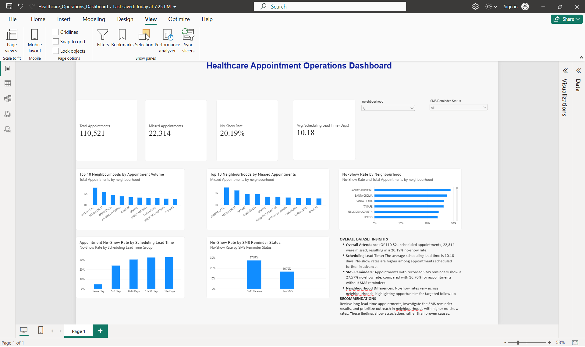

# Healthcare Operations Analytics

### End-to-End Healthcare Data Analysis Using Python, SQL, SQLite, and Power BI

## Project Overview

This project analyzes **110,521 medical appointment records** to investigate patient attendance patterns, missed appointments, scheduling lead times, and differences across neighbourhoods.

The objective is to transform raw healthcare appointment data into actionable operational insights that can help healthcare organizations identify areas for further investigation and improve appointment management strategies.

The project demonstrates an end-to-end data analytics workflow, including data inspection, cleaning, database development, SQL analysis, KPI calculation, and interactive dashboard development.

## Technologies Used

| Technology | Purpose |
|---|---|
| Python | Data processing and automation |
| Pandas | Data cleaning, validation, and transformation |
| SQL | Querying and analyzing appointment records |
| SQLite | Relational data storage |
| Power BI | Interactive dashboard development |
| DAX | KPI measures and calculations |
| Visual Studio Code | Development environment |
| Git and GitHub | Version control and project documentation |

## Project Workflow

1. **Data Inspection:** Examine the raw appointment dataset to understand its structure, data types, and potential quality issues.
2. **Data Cleaning:** Use Python and Pandas to prepare and validate appointment records.
3. **Database Development:** Store the cleaned dataset in a SQLite database for structured querying.
4. **SQL Analysis:** Analyze appointment volume, missed appointments, no-show rates, and demographic and scheduling patterns.
5. **Dashboard Development:** Build an interactive Power BI dashboard using DAX measures and visualizations.
6. **Business Insights:** Interpret analytical findings and develop evidence-based operational recommendations.

## Key Performance Indicators

| KPI | Result |
|---|---|
| Total Appointments | 110,521 |
| Missed Appointments | 22,314 |
| Overall No-Show Rate | 20.19% |
| Average Scheduling Lead Time | 10.18 days |

The no-show rate is calculated as:

**No-Show Rate = (Missed Appointments / Total Appointments) × 100**

These KPIs provide an overview of appointment attendance and scheduling performance.

## Power BI Dashboard



The interactive dashboard includes:

- Total appointments, missed appointments, no-show rate, and average scheduling lead time
- Top 10 neighbourhoods by appointment volume
- Top 10 neighbourhoods by missed appointments
- No-show rates across neighbourhoods
- No-show rates by scheduling lead time
- No-show rates by SMS reminder status
- Interactive filters for neighbourhood and SMS reminder status

The dashboard allows users to explore appointment attendance patterns across different patient and scheduling groups.

## Key Analytical Findings

### 1. Overall Appointment Attendance

Of the 110,521 appointment records analyzed, 22,314 were classified as missed appointments, representing an overall no-show rate of 20.19%.

Approximately one in five scheduled appointments was missed.

### 2. Scheduling Lead Time

The analysis identified higher no-show rates among appointments scheduled further in advance.

The average scheduling lead time across the dataset was 10.18 days.

This finding suggests that scheduling lead time may be a useful factor for identifying appointments requiring additional attention.

### 3. SMS Reminder Status

Appointments with recorded SMS reminders showed an observed no-show rate of 27.57%, compared with 16.70% for appointments without recorded reminders.

This difference does not establish that SMS reminders increase missed appointments. Other factors, including patient characteristics, appointment scheduling, and reminder assignment, may influence the observed relationship.

### 4. Neighbourhood Differences

Appointment volume and no-show rates varied across neighbourhoods.

These differences highlight opportunities for further analysis of local appointment attendance patterns and operational challenges.

## Operational Recommendations

Based on the observed patterns, the following actions are recommended:

1. **Review long-lead-time appointments:** Investigate whether appointments scheduled further in advance require additional confirmation or follow-up.
2. **Evaluate SMS reminder processes:** Examine reminder assignment, delivery, timing, and patient characteristics before drawing conclusions about effectiveness.
3. **Investigate neighbourhood-level differences:** Identify areas with consistently elevated no-show rates and explore potential contributing factors.
4. **Monitor attendance KPIs:** Use the Power BI dashboard to review appointment attendance patterns and support operational decision-making.
5. **Evaluate interventions:** Test proposed changes and measure their impact before implementing broader operational policies.

## Project Structure

```text
Healthcare-Operations-Analytics/
│
├── dashboards/
│   └── Healthcare_Operations_Dashboard.pbix
│
├── data/
│   ├── raw/
│   └── cleaned/
│
├── database/
│   └── healthcare.db
│
├── images/
│   └── healthcare_dashboard.png
│
├── reports/
│   ├── data_quality_report.csv
│   ├── invalid_records.csv
│   ├── no_show_by_age_group.csv
│   ├── no_show_by_gender.csv
│   ├── no_show_by_neighbourhood.csv
│   └── no_show_by_waiting_group.csv
│
├── scripts/
│   ├── 01_inspect_data.py
│   ├── 02_clean_data.py
│   ├── 03_create_database.py
│   └── 04_run_sql_analysis.py
│
├── sql/
│   └── 01_healthcare_analysis.sql
│
├── .gitignore
├── README.md
└── requirements.txt
```

*Note: Raw datasets and the local SQLite database may be excluded from GitHub through `.gitignore`.*

## Data Source

**Medical Appointment No Shows — Kaggle**

The dataset contains medical appointment records used to examine patient attendance and scheduling patterns.

The project uses the dataset for educational and portfolio purposes.

## Limitations

This project is based on observational data.

Relationships between appointment scheduling, SMS reminder status, neighbourhood, and missed appointments should not be interpreted as causal effects.

Additional statistical analysis and evaluation would be required to establish whether proposed interventions improve appointment attendance.

## Skills Demonstrated

- Data cleaning and preprocessing
- Data validation and quality assessment
- SQL querying and aggregation
- Relational database development
- KPI design and calculation
- DAX measures
- Power BI data visualization
- Exploratory data analysis
- Healthcare operational analytics
- Business insights and recommendations
- Technical documentation

## Project Purpose

This project was developed to demonstrate practical data analytics skills through a healthcare operations use case, combining Python, SQL, and Power BI to transform appointment records into interpretable metrics and operational recommendations.